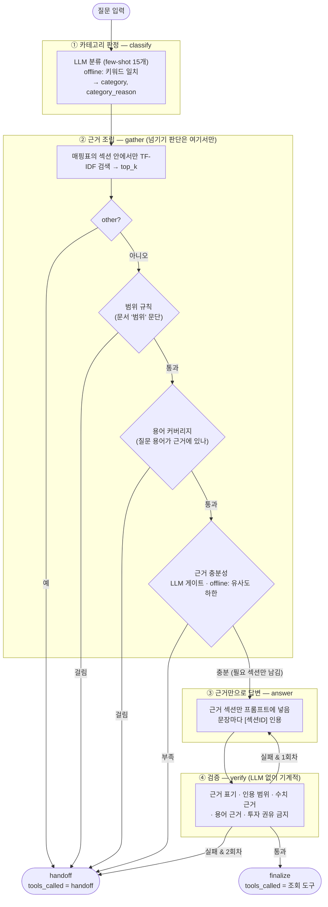
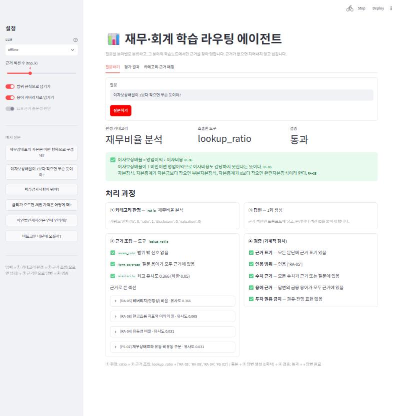
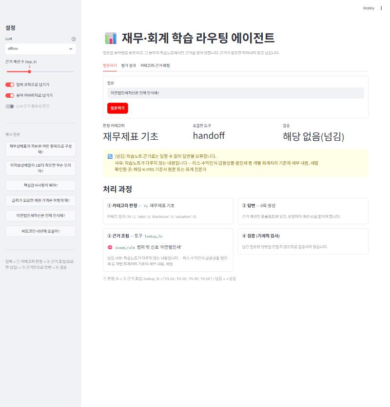
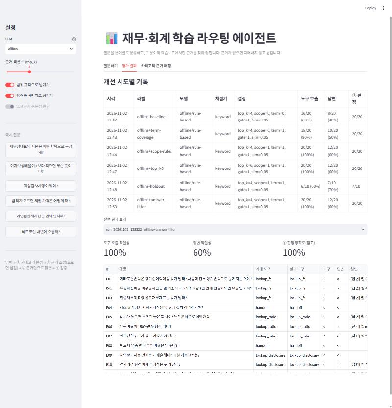

# REPORT — AI Financial Learning & Analysis Agent

재무·회계 질문을 분야별로 분류하고, 그 분야의 학습노트에서만 근거를 찾아 답하며, 근거가 없으면 답을 지어내지 않고 넘기는 라우팅 에이전트.

```
입력 하나 → ① 카테고리 판정 → ② 카테고리별 근거 조립 → ③ 근거만으로 답변 → ④ 검증
                                   ↓
                             모르겠으면 넘기기
```

> ⚠️ **측정 현황**: 아래 수치는 모두 API 키 없이 돈 **offline 모드**(키워드 분류 + 추출형 답변 + 키워드 채점기) 결과다.
> Gemini 모드 측정은 `.env`에 키를 넣고 `python evaluate.py --label gemini-baseline`을 실행하면 `results/history.md`에 자동으로 기록된다. 실행 후 §4의 표에 옮겨 적는다.

---

## 1. 주제와 근거 문서

**주제**: 재무·회계·금융 기초 지식 학습 도우미.

고른 이유
- 프로젝트 목적이 ① 회계·재무 핵심 개념을 체계적으로 익히고 ② 실제 공시자료를 읽는 능력을 기르고 ③ 그 지식을 에이전트의 근거 데이터로 쌓는 것이다. 근거 문서를 직접 정리하는 일 자체가 학습이 된다.
- **그럴듯한 오답이 많은 분야다.** "적정 PER은 10배", "유동비율 200% 미만이면 위험", "금융소득 2천만 원 넘으면 종합과세"처럼 인터넷에 흔한 통념이나 근거 문서 밖의 사실을 LLM이 자신 있게 말하기 쉽다. 검증과 넘기기가 실제로 필요한 도메인이다.
- 분야마다 답의 성격이 다르다: 기준서 정의(재무제표), 공식과 해석(비율), 법정 기한과 절차(공시), 수식과 가정(가치평가).

**근거 문서** (`docs/`, 4개 문서 · 38개 섹션 · 297줄). 기준서·법령 원문을 요약·재구성한 학습노트이며, 섹션마다 `[FS-01]` 같은 ID를 붙여 인용과 검증을 기계적으로 할 수 있게 했다. 각 문서 머리에 **다루지 않는 범위**를 명시했고, 이 문장이 넘기기 규칙의 근거가 된다.

| 문서 | 근거 출처 | 섹션 |
|---|---|---|
| `01_financial_statements.md` 재무제표 기초 | K-IFRS 제1001·1007·1110·1027호, 개념체계(2018) | FS-01~10 |
| `02_ratio_analysis.md` 재무비율 분석 | 재무제표분석 교재의 표준 비율 정의 | RA-01~09 |
| `03_disclosure.md` 공시·감사보고서 | 자본시장법 제159~161조, 외부감사법, 감사기준서 700·705·706, DART 안내 | DS-01~09 |
| `04_valuation.md` 가치평가·금융 기초 | 기업재무·투자론 표준 공식, K-IFRS 제1033호 | VA-01~10 |

---

## 2. 카테고리 설계

### 나눈 기준
**"답의 근거가 어디서 오고, 답의 성격이 어떻게 다른가"**로 나눴다. 같은 단어(예: '영업이익')가 나와도 재무제표에서 어떻게 표시되는지(fs), 어떤 비율에 쓰이는지(ratio), 공시에서 어디서 찾는지(disclosure), 가치평가에서 어떻게 쓰이는지(valuation)는 다른 문서에서 답해야 한다.

| 키 | 카테고리 | 답의 성격 | 도구 |
|---|---|---|---|
| `fs` | 재무제표 기초 | 기준서의 정의·분류·표시 규칙 | `lookup_fs` |
| `ratio` | 재무비율 분석 | 공식 + 해석 원칙(절대 기준 없음) | `lookup_ratio` |
| `disclosure` | 공시·감사보고서 | 법정 기한·문서 구조·감사의견 | `lookup_disclosure` |
| `valuation` | 가치평가·금융 기초 | 수식과 가정 | `lookup_valuation` |
| `other` | 기타(범위 밖) | 답하지 않음 | 없음 → `handoff` |

`other`는 투자 추천, 주가 전망, 세무 신고, 특정 회사 실적 조회, 무관한 질문을 담는다.

### 카테고리 ↔ 근거 매핑표
`context.py`의 `CATEGORIES`가 이 표 그대로다. ② 근거 조립은 **해당 카테고리에 매핑된 섹션 안에서만** 검색하고, 상위 `top_k`(기본 4)개만 프롬프트에 넣는다. 문서 전체를 넣지 않는다.

| 카테고리 | 연결 섹션 | 교차 연결 이유 | 다루지 않는 범위(→ 넘김) | 넘길 곳 |
|---|---|---|---|---|
| fs | FS-01~FS-10 | — | 리스·수익인식·금융상품·법인세 등 개별 기준 세부, 세법 | K-IFRS 원문, 회계 전문가 |
| ratio | RA-01~RA-09 + **FS-02** | 유동비율 해석에 유동/비유동 분류 기준이 필요 | 업종 평균값, 특정 기업 비율, 신용등급 기준 | 한국은행 기업경영분석 등 |
| disclosure | DS-01~DS-09 + **FS-10** | 공시에서 연결/별도를 구분해 읽어야 함 | 특정 회사 공시 내용·실적, 거래소 상장규정 조치 | DART 원문, 거래소 규정 |
| valuation | VA-01~VA-10 + **FS-04** | EBITDA 계산에 영업이익 정의가 필요 | 특정 시점 시장 수치(MRP 등), 목표주가·매매 판단 | 평가 기준일 시장 자료 |
| other | (없음) | — | 전부 | 세무사·투자자문업자·DART |

`context.check_mapping()`이 매핑된 섹션이 실제로 있는지, 어느 카테고리에도 연결되지 않은 섹션이 없는지 검사한다(현재 문제 0건). 공시 문서(03)만으로는 "사업보고서에서 어느 숫자를 봐야 하나"에 답할 연결/별도 구분 설명이 없어, 같은 내용을 공시 문서에 중복해 쓰지 않고 FS-10을 교차 연결했다. 교차 연결은 이렇게 "다른 카테고리의 질문에 답하는 데 꼭 필요한 섹션"에만 썼다.

---

## 3. 평가셋 설계

`data/goldenset.json` — **20문항, 카테고리당 4문항씩 균등**.

| 카테고리 | 답할 수 있는 문항 | 넘겨야 하는 문항 |
|---|---|---|
| fs | E01 기타포괄손익 재분류, E02 유동/비유동 기준, E03 연결/별도 | E04 리스 사용권자산 상각 기간 |
| ratio | E05 듀폰분석, E06 유동비율 150%, E07 현금전환주기 | E08 반도체 업종 평균 부채비율 |
| disclosure | E09 정기보고서 제출 기한, E10 한정 vs 부적정, E11 사업보고서에서 재무제표 찾기 | E12 한정의견이면 상장폐지? |
| valuation | E13 적정 PER, E14 WACC와 (1−t), E15 복리 계산 | E16 요즘 시장위험프리미엄 |
| other | — | E17 종목 매수, E18 금융소득 종합과세, E19 특정 회사 실적, E20 엑셀 |

**넘김이 정답인 문항 8건(40%).** 그중 4건(E04·E08·E12·E16)은 분야는 맞지만 근거 문서에 답이 없는 문항이라, ① 판정은 맞혀도 ②에서 넘겨야 한다. 이 4건이 "카테고리 판정"과 "넘기기 판단"을 분리했는지 시험한다.

문항마다 적은 것
- **기대 도구**: 정답 근거가 있는 섹션(`evidence`)이 속한 카테고리의 도구. 근거 섹션이 없으면 `handoff`.
- **반드시 담을 사실**(총 32개): 근거 섹션에 명시된 문장에서만 뽑았다. 근거에 없는 사실은 필수로 넣지 않았다.
- **말하면 안 되는 것**(총 22개): 문서를 안 읽었을 때 나오기 쉬운 그럴듯한 오답을 넣었다. 예: "적정 PER은 10배"(E13), "매입채무지급기간을 더한다"(E07), "한정의견은 의견을 표명하지 않은 것"(E10, 의견거절과 혼동), "금융소득 2,000만 원"(E18, 사실이지만 근거 밖), "리스기간과 내용연수 중 짧은 기간"(E04, 사실이지만 근거 밖). **사실이어도 근거에 없으면 말하면 안 된다**는 점이 이 프로젝트의 핵심이다.
- **모범 답안 / 오답**: 채점기 검증용.

**예시용과 평가용 분리**: 프롬프트 예시는 `data/fewshot.json`에만 둔다(분류 예시 15개, 충분성 판단 예시 2개, 답변 예시 1개). `evaluate.py`가 실행할 때마다 두 파일의 질문 유사도를 검사해 겹침이 없음을 확인한다.

**과적합 점검용 미공개 문항**: `data/holdout.json` 10문항. offline 넘기기 규칙을 만든 **뒤에** 작성했고, 이 문항을 보고 규칙을 고치지 않는다.

---

## 4. 측정 결과

### 지표 정의
- **도구 호출 적절성**: 최종적으로 답에 쓴 도구 집합이 기대 도구와 정확히 같으면 1점. 넘겼으면 도구 집합은 `{handoff}`. 다른 근거를 고른 것, 넘겨야 하는데 답한 것, 답할 수 있는데 넘긴 것이 모두 여기서 걸린다.
- **답변 적절성**: 반드시 담을 사실을 전부 담고 말하면 안 되는 것을 하나도 말하지 않으면 1점. 넘김이 정답인 문항은 실제로 넘기고 넘김 문구에 금지 내용이 없어야 1점.

### 채점기 검증 (모범 답안으로 채점기 자체를 검증)
`python evaluate.py --validate-grader` — 문항마다 모범 답안은 1점, 오답은 0점이 나와야 한다.

| 채점기 | 일치 | 비고 |
|---|---|---|
| 키워드 채점기(offline) | **40/40** | 부정 표현("~라고 단정할 수 없다")을 위반으로 잡지 않도록 금지 패턴에 부정 예외를 넣었다 |
| LLM 채점기(Gemini) | _실행 대기_ | 프롬프트에 "표현이 아니라 사실을 보라", "부정·반박은 위반이 아니다"를 명시 (`prompts.JUDGE_SYSTEM`) |

### 개선 시도별 기록표 (한 번에 하나씩 바꾸고 다시 측정)
원본은 `results/history.md`, 문항별 결과는 `results/run_*.json`, 오답 분석은 `results/run_*_errors.md`.

| # | 바꾼 것 | 도구 호출 | 답변 | 판단 |
|---|---|---|---|---|
| 0 | offline 기준선: 넘기기는 유사도 하한만 | 16/20 (80%) | 8/20 (40%) | 넘겨야 할 E04·E08·E12·E16을 모두 답함 |
| 1 | + **용어 커버리지**(질문의 금융 용어가 카테고리 근거에 없으면 넘김) | 18/20 (90%) | 10/20 (50%) | E04(사용권자산)·E12(상장폐지) 해결 |
| 2 | + **범위 규칙**(문서 '범위' 문단 → 정규식) | 20/20 (100%) | 12/20 (60%) | E08(업종 평균)·E16(요즘 몇 %) 해결 |
| 3 | top_k 4 → 6 | 20/20 | 12/20 | 변화 없음 → **되돌림**(프롬프트만 길어짐) |
| 4 | offline 답변에 관련도 필터(최고 문장 대비 0.35 미만 제외) | 20/20 | 12/20 | 점수는 같지만 엉뚱한 문장이 빠져 데모 품질 향상 → 유지 |
| H | **미공개 10문항**에 #4 설정 그대로 적용 | **6/10 (60%)** | — | **규칙이 평가셋에 과적합**됨을 확인 (아래) |
| 5 | Gemini 모드 기준선 | _실행 대기_ | _실행 대기_ | `python evaluate.py --label gemini-baseline` |
| 6 | Gemini + LLM 게이트 끔 | _실행 대기_ | _실행 대기_ | `--no-llm-gate` — LLM 게이트의 기여 측정 |
| 7 | Gemini + 미공개 문항 | _실행 대기_ | — | `--data data/holdout.json --label gemini-holdout` |

### 틀린 건 원인 분류 (offline #4, 직접 읽은 결과)
**도구 호출 오류: 0건.** **답변 오류: 8건 — 전부 "필수 사실 누락", 금지 위반 0건.**

| 원인 | 문항 | 무엇이 빠졌나 |
|---|---|---|
| 근거는 맞게 조립했으나 추출형 답변이 5문장 제한에 걸려 목록 항목을 놓침 | E01, E02, E03, E07, E10 | E01 재분류 안 되는 항목 예시, E02 단기매매 목적, E03 비지배지분, E07 "365 ÷ 회전율", E10 한정의견 정의 |
| 공식이 여러 줄에 나뉜 문장이라 한 문장 단위 추출로 공식 전체를 못 가져옴 | E05 | "ROE = 순이익률 × 총자산회전율 × 재무레버리지" 줄이 질문과 글자 유사도가 낮아 탈락 |
| **필요한 섹션이 top_k에 못 들어감**(검색 오류) | E06 (RA-01 누락), E11 (DS-03 누락) | E06 "업종·추세와 비교", E11 "III. 재무에 관한 사항" |

→ offline의 답변 오류는 **근거 선택은 맞고 문장 생성이 약한 문제**가 대부분(6/8)이다. LLM이 근거를 종합해 쓰면 해결될 성격이다. E06·E11은 글자 n-gram 유사도의 한계라 LLM 모드에서도 남을 수 있다. 다음 개선 후보는 `ratio`에서 RA-01(비율분석 원칙)을 항상 포함하는 것이다.

### 미공개 문항에서 드러난 과적합 (#H, 직접 읽은 결과)
| 문항 | 결과 | 원인 |
|---|---|---|
| H02 영업이익은 어떻게 계산해? | 답할 수 있는데 넘김 | ① 키워드 목록에 '영업이익'이 없어 `other`로 분류 |
| H06 적정의견인데 계속기업 불확실성 문단이…? | 다른 근거 조회 | ① '계속기업'이 fs 키워드라 fs로 분류(정답 disclosure) |
| H08 LG에너지솔루션 PER 지금 몇 배야? | **넘겨야 하는데 답함** | 범위 규칙이 "몇 %"만 잡고 "몇 배"는 못 잡음 |
| H10 코스닥 상장 요건이 뭐야? | **넘겨야 하는데 답함** | '상장 요건'은 규칙에도 용어 사전에도 없음 |

평가셋에서 100%였던 규칙이 미공개 문항에서 60%로 떨어졌다. **규칙은 내가 본 질문만 막는다.** H08·H10처럼 넘겨야 하는데 답하는 건 가장 위험한 오류라서, "근거만으로 답할 수 있는가"를 질문 의미로 판단하는 LLM 게이트(`prompts.sufficiency_prompt`)가 필요하다. 미공개 문항을 보고 규칙을 고치면 이 점검이 무의미해지므로 고치지 않았다.

---

## 5. 파이프라인 구조도



**State (`agent.AgentState`)** — 노드마다 채우는 필드

| 노드 | 읽는 필드 | 쓰는 필드 |
|---|---|---|
| classify | question | category, category_reason |
| gather | question, category | tool, sections, scores, gate, sufficient, handoff_reason |
| answer | question, sections, verification(재시도 시 실패 사유) | answer, attempts |
| verify | answer, sections, question | verification |
| handoff | category, handoff_reason, verification | status="handoff", answer(넘김 문구), tools_called=["handoff"] |
| finalize | tool | status="answered", tools_called=[tool] |

설계에서 지킨 원칙
- **판정과 넘기기의 분리**: ① 프롬프트에 "답을 아는지, 근거가 있는지는 판단하지 않는다"고 명시했다. ①에는 "모르겠음" 선택지가 없다. 넘김은 ②의 게이트(규칙 → 용어 → 충분성)와, ④ 검증 2회 실패에서만 일어난다.
- **기계적 검증**(`verify.py`): ① 문단마다 섹션 ID가 있는가 ② 인용한 ID가 이번에 조립한 근거 안에 있는가 ③ 답변의 모든 숫자가 근거나 질문에 있는가 ④ 답변의 금융 용어(사전 88개)가 근거에 있는가 ⑤ 매수·매도 권유 표현이 없는가. 질문에 숫자가 있는 계산 문제는 계산 결과 숫자를 실패가 아니라 경고로 둔다.
- 검증에 실패해 넘길 때, 넘김 문구에 실패 내용(지어낸 숫자·용어)을 넣지 않는다. 가짜 LLM 테스트에서 지어낸 숫자 '120'이 넘김 문구로 새는 것을 발견해 고쳤다.

---

## 6. 데모 설계

`streamlit run app.py`

| 답변한 경우 | 넘긴 경우 |
|---|---|
|  |  |



신경 쓴 부분
- **답만 보여주지 않고 처리 과정 4단계를 나란히 보여준다.** 판정 카테고리, 호출한 도구, 검증 결과를 맨 위 지표 3개로 두고, 아래에 ①~④ 카드를 둔다. "왜 이 답이 나왔는지 / 왜 넘겼는지"를 사용자가 확인할 수 있어야 학습 도구로 믿을 수 있다.
- **넘김을 실패처럼 보이지 않게 했다.** 넘김은 노란 상자에 사유와 "확인할 곳"(기준서 원문, DART, 세무사 등)을 함께 보여준다. 넘김 화면에서 ①은 `fs`로 맞게 판정하고 ②에서 `scope_rule`로 넘긴 과정이 보여, 판정과 넘기기가 분리되어 있음을 화면에서 확인할 수 있다.
- **근거 섹션 원문을 펼쳐 볼 수 있다.** 답변의 `RA-05` 같은 인용 배지와 ② 카드의 섹션 원문을 대조할 수 있다.
- **실험 손잡이를 사이드바에 노출했다.** top_k, 범위 규칙, 용어 커버리지, LLM 게이트를 켜고 끄면서 넘기기 동작이 어떻게 바뀌는지 직접 볼 수 있다. 평가 결과 탭에서 개선 기록표와 문항별 오답 원인을 본다.
- API 키가 없어도 offline 모드로 화면 전체가 동작한다.

---

## 7. 프로젝트 회고

**가장 공들인 부분**
- **"사실이어도 근거에 없으면 말하지 않는다"를 평가셋에 넣은 것.** E04(리스 상각 기간)·E18(금융소득 2천만 원)은 LLM이 정답을 알고 있을 가능성이 높은 질문이다. 그래서 오히려 근거 기반 시스템이 지켜야 할 선을 가장 잘 시험한다.
- **채점기를 먼저 검증한 것.** 키워드로 금지 표현을 잡으면 "~라고 단정할 수 없다" 같은 부정문까지 위반으로 잡기 쉽다. 그래서 금지 패턴에 부정 예외를 넣었고, 모범 답안 20개와 오답 20개로 40/40을 확인한 뒤에야 에이전트를 측정했다.
- **미공개 문항으로 내 규칙을 의심한 것.** 평가셋 100%에서 멈췄다면 규칙이 잘 동작한다고 착각했을 것이다.

**향후 보완**
1. Gemini 모드 측정 완료 후 §4 표 채우기, LLM 채점기 검증(모범/오답 40건) 결과 기록.
2. 검색 개선: 글자 n-gram TF-IDF는 E06·E11처럼 필요한 섹션을 놓친다. 임베딩 검색을 쓰거나, 카테고리마다 항상 넣는 '원칙 섹션'(RA-01 등)을 지정한다.
3. 용어 사전(`FIN_TERMS`)과 범위 규칙을 수작업 목록이 아니라 문서에서 자동 추출한다.
4. 계산 문제 검증: 지금은 계산 결과 숫자를 경고로만 둔다. 답변의 계산식을 파싱해 다시 계산하는 검증을 넣고 싶다.
5. 근거 문서 확장: 리스(K-IFRS 1116)·수익인식(1115)·금융상품(1109)을 학습하면서 문서와 카테고리를 늘린다. 문서가 늘면 지금 넘기는 E04 같은 질문이 답할 수 있는 질문으로 바뀌므로, 평가셋의 기대 도구도 함께 갱신해야 한다.
6. 실제 공시 연결: Open DART API로 특정 회사 재무제표를 가져와 "이 회사 ROE 계산해 줘" 같은 질문에 공시 수치를 근거로 답하는 도구를 추가한다(지금은 E19처럼 넘김).
