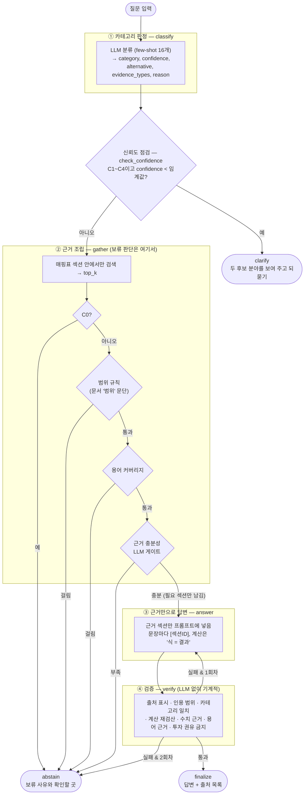
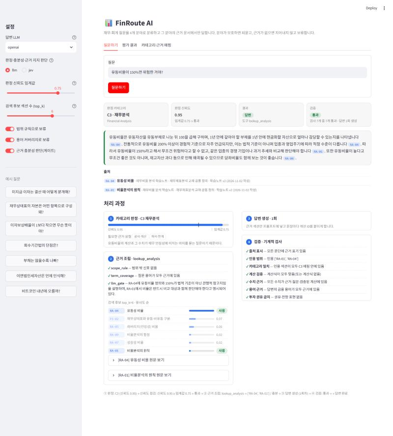
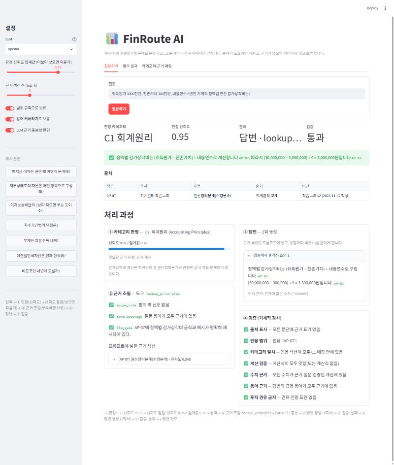
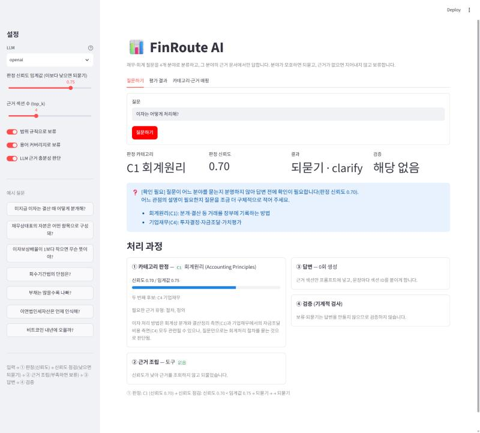
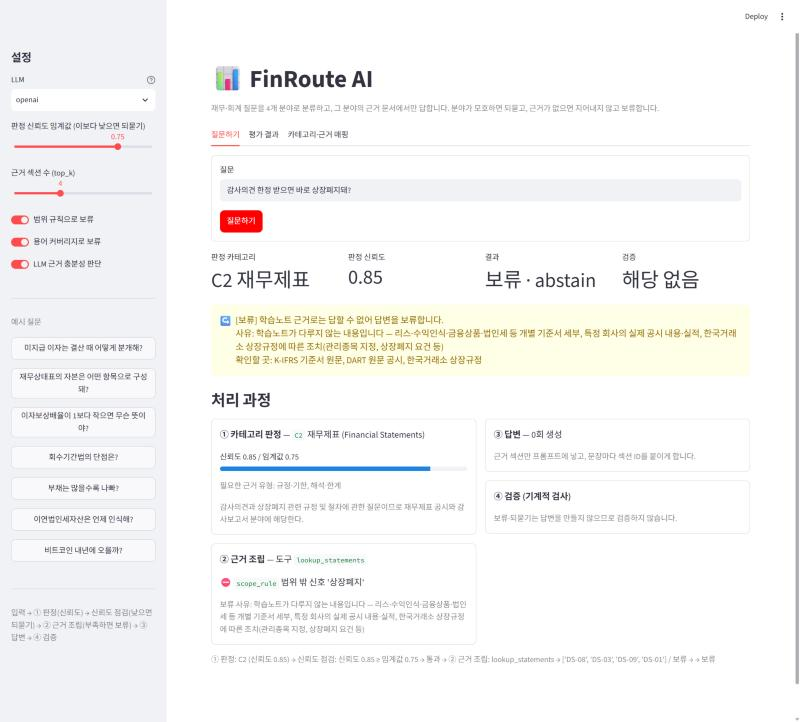

# REPORT — FinRoute AI

**Financial & Accounting Knowledge Routing Agent.** 재무·회계 질문을 4개 전문 분야로 분류하고, 그 분야의 근거 문서에서만 답한다. 분야가 모호하면 되묻고, 근거가 없으면 답을 지어내지 않고 보류한다.

```
입력 → ① 카테고리 판정(신뢰도) → 신뢰도 점검 → ② 카테고리별 근거 조립 → ③ 근거만으로 답변 → ④ 검증
                                    ↓                    ↓                                    ↓
                            낮으면 되묻기         근거 부족이면 보류                  2회 실패하면 보류
```

**최종 결과** (OpenAI `gpt-4.1-mini`, 평가셋 50문항, LLM 채점기)

| 과제 지표 | | PRD 지표 | | |
|---|---|---|---|---|
| 도구 호출 적절성 | **48/50 (96%)** | 분류 정확도 | 47/50 (94%) | 목표 90% ✅ |
| 답변 적절성 | **47/50 (94%)** | 근거 적합성 | 29/32 (91%) | 목표 90% ✅ |
| 미공개 10문항 도구 호출 | 10/10 (100%) | 답변 정확성(근거 충실도) | 31/32 (97%) | 목표 90% ✅ |
| | | 근거 없는 정보 생성 | **0/34 (0%)** | |
| | | 보류 정확도 | 48/50 (96%) | 목표 90% ✅ |

> 이 문서는 2차 버전(v2)이다. 1차 버전(카테고리 5개, 평가 20문항)의 기록은 `results/v1/`에 남겨 두었고 §4 끝에 요약했다.

---

## 1. 주제와 근거 문서

**주제**: 회계·재무를 공부하는 대학생과 취업 준비생을 위한 재무·회계 학습 도우미.

고른 이유
- 프로젝트 목적이 ① 회계·재무 핵심 개념을 체계적으로 익히고 ② 재무제표와 공시를 읽는 능력을 기르고 ③ 그 지식을 에이전트의 근거 데이터로 쌓는 것이다. 근거 문서를 직접 정리하는 일 자체가 학습이 된다.
- **그럴듯한 오답이 많은 분야다.** "적정 PER은 10배", "차변은 돈이 들어오는 것", "IRR이 높은 쪽을 고른다", "금융소득 2천만 원 넘으면 종합과세"처럼 흔한 통념이나 근거 밖 사실을 LLM이 자신 있게 말하기 쉽다.
- 분야마다 답의 성격이 다르다: 기록 규칙(회계원리), 기준서의 분류·표시(재무제표), 공식과 해석(재무분석), 수식과 이론(기업재무).

**근거 문서** (`docs/`, 6개 문서 · 52개 섹션). 기준서·법령·교재를 요약·재구성한 학습노트다. 원문을 그대로 옮기지 않아 공개 저장소에 올릴 수 있다. 섹션마다 다음 메타데이터가 붙는다.
- 섹션 ID(`[AP-04]`)
- 출처 줄(`> 출처: K-IFRS 제1001호 문단 60~76`)
- 문서 머리의 버전(`학습노트 v2 (2026-11-02 작성)`)과 **다루지 않는 범위**

출처는 기준서 문단·법령 조문까지 적을 수 있는 경우에만 번호를 적었다. 교재 수준 내용은 "회계원리 교재"처럼 출처 종류만 적었다. 번호를 추측해서 적으면 그 자체가 근거 없는 정보이기 때문이다.

| 문서 | 섹션 | 근거 출처 |
|---|---|---|
| `01_accounting_principles.md` 회계원리 | AP-01~08 | 개념체계 4장·1.17, 회계원리 교재 |
| `02_financial_statements.md` 재무제표 | FS-01~10 | K-IFRS 제1001·1007·1110·1027호, 개념체계 |
| `03_disclosure.md` 공시·감사보고서 | DS-01~09 | 자본시장법 제159~161조, 외부감사법, 감사기준서 570·700·701·705·706 |
| `04_financial_analysis.md` 재무분석 | RA-01~09 | 재무제표분석 교재 공통 정의 |
| `05_valuation.md` 가치평가·금융 기초 | VA-01~10 | 기업재무 교재, K-IFRS 제1033호 |
| `06_corporate_finance.md` 투자결정·자금조달·자본구조 | CF-01~06 | 기업재무 교재, Modigliani & Miller(1958, 1963) |

---

## 2. 카테고리 설계

### 나눈 기준
**"답의 근거가 어디서 오고, 답의 성격이 어떻게 다른가."** 같은 '감가상각'이라도 결산 때 어떻게 분개하는지(C1), 재무제표에 어떻게 표시되는지(C2), 비율에 어떤 영향을 주는지(C3)는 서로 다른 문서에서 답해야 한다. PRD의 4개 분야에 과제 요구사항인 "어디에도 속하지 않는 것" 카테고리(C0)를 더했다.

| 키 | 카테고리 | 답의 성격 | 도구 |
|---|---|---|---|
| C1 | 회계원리 (Accounting Principles) | 기록 규칙·절차 | `lookup_principles` |
| C2 | 재무제표 (Financial Statements) | 기준서의 분류·표시, 공시·감사보고서 읽기 | `lookup_statements` |
| C3 | 재무분석 (Financial Analysis) | 비율 공식과 해석(절대 기준 없음) | `lookup_analysis` |
| C4 | 기업재무 (Corporate Finance) | 시간가치·자본예산·자본구조·자본비용 | `lookup_corpfin` |
| C0 | 지원하지 않는 질문 | 답하지 않음 | 없음 → `abstain` |

1차 버전의 '공시·감사보고서' 카테고리는 C2에 합쳤다. 공시를 읽는 목적이 결국 재무제표를 찾고 해석하는 것이고, 프로젝트 목표 ②(공시 읽기)를 살리기 위해서다.

### 카테고리 ↔ 근거 매핑표
`context.py`의 `CATEGORIES`가 이 표 그대로다. ② 근거 조립은 **해당 카테고리에 매핑된 섹션 안에서만** 검색하고, 상위 `top_k`(기본 4)개만 프롬프트에 넣는다.

| 카테고리 | 연결 섹션 | 교차 연결과 이유 | 다루지 않는 범위(→ 보류) | 넘길 곳 |
|---|---|---|---|---|
| C1 회계원리 | AP-01~08 + **FS-03** | 회계등식 설명에 자산·부채·자본의 정의가 필요 | 세무회계, 원가·관리회계, 개별 기준서 세부 | 세무사, 원가회계 교재, K-IFRS 원문 |
| C2 재무제표 | FS-01~10 + DS-01~09 | — (공시 문서 전체를 포함) | 개별 기준서 세부, 특정 회사 공시·실적, 거래소 상장규정 조치 | K-IFRS 원문, DART, 거래소 규정 |
| C3 재무분석 | RA-01~09 + **FS-02** | 유동비율 해석에 유동/비유동 분류 기준이 필요 | 업종 평균값, 특정 기업 비율, 신용등급 기준 | 한국은행 기업경영분석 등 |
| C4 기업재무 | VA-01~10 + CF-01~06 + **FS-04** | EBITDA 계산에 영업이익 정의가 필요 | 현재 시장 수치, 특정 기업 투자안 평가, 목표주가·매매 판단 | 평가 기준일 시장 자료 |
| C0 | (없음) | — | 전부 | 세무사·투자자문업자·DART |

`context.check_mapping()`이 매핑된 섹션이 실제로 있는지, 어느 카테고리에도 연결되지 않은 섹션이나 출처 줄이 없는 섹션이 없는지 검사한다(현재 문제 0건). PRD의 C1(분개·결산)과 C4의 NPV·IRR·자본구조는 1차 버전 문서에 없어서, `01_accounting_principles.md`와 `06_corporate_finance.md`를 새로 써서 보강했다.

---

## 3. 평가셋 설계

`data/goldenset.json` — **50문항.**

| 카테고리 | 답할 수 있는 문항 | 보류가 정답인 문항 |
|---|---|---|
| C1 회계원리 (10) | 분개 예시, 차변·대변 규칙, 시산표 한계, 발생주의/현금주의, 선급보험료 결산분개, **감가상각 계산(문서와 다른 숫자)**, 마감, 선수/미수수익 | 세무조정, 제조간접비 배부 |
| C2 재무제표 (10) | OCI 재분류, 유동/비유동, 연결/별도, 정기보고서 기한, 한정 vs 부적정, DART에서 재무제표 찾기, 이자 지급 분류, 배당과 비용 | 리스 사용권자산 상각, 한정의견 시 상장폐지 |
| C3 재무분석 (10) | 듀폰, 유동비율 150%, 현금전환주기, ROA vs ROE, 당좌비율, 부채비율·자본잠식, 영업CF < 순이익, 흑자전환 증가율 | 업종 평균 부채비율, 신용등급용 부채비율 |
| C4 기업재무 (10) | 적정 PER, WACC와 (1−t), 복리 계산, NPV 규칙, **NPV 계산**, IRR vs NPV, 부채 조달 장단점, 법인세 MM | 현재 시장위험프리미엄, 특정 회사 공장 투자 판단 |
| C0 (7) | — | 종목 매수, 금융소득 종합과세, 특정 회사 실적, 엑셀, 코스피 전망, 연말정산, 크롤링 |
| 모호 (3) | — | **되묻기가 정답**: "레버리지가 뭐야?"(C3/C4), "이자는 어떻게 처리해?"(C1/C2), "배당은 어떻게 봐야 해?"(C2/C4) |

정답 행동은 **답변 32건 · 보류 15건 · 되묻기 3건**이다. 보류 문항 중 8건은 분야는 맞지만 근거 문서에 답이 없는 문항이다. 이 문항들은 ① 판정은 맞혀도 ②에서 보류해야 하므로 "판정"과 "보류 판단"이 분리되었는지 시험한다.

문항마다 적은 것
- **기대 도구**: 정답 근거 섹션(`evidence`)이 속한 카테고리의 도구. 근거가 없으면 `abstain`, 모호하면 `clarify`. 분류가 둘 다 말이 되는 문항은 `acceptable_categories`로 허용 범위를 적었다(예: 세무조정은 C1 또는 C0).
- **반드시 담을 사실**(76개): 근거 섹션에 명시된 문장에서만 뽑았다.
- **말하면 안 되는 것**(49개): 문서를 안 읽었을 때 나오기 쉬운 그럴듯한 오답이다. 예를 들면 "차변 현금·대변 비품"(분개 반대로), "잔존가치를 빼지 않은 5,000,000원", "IRR을 따른다", "할인하지 않은 NPV 200원", "금융소득 2,000만 원"(사실이지만 근거 밖).
- **모범 답안 / 오답**: 채점기 검증용.

**계산 문항은 일부러 문서와 다른 숫자를 썼다**(P06 감가상각). 문서 예시를 그대로 베끼는지, 공식을 적용해 계산하는지를 가르고, ④ 계산 검증을 시험하기 위해서다.

**예시용과 평가용 분리**: 프롬프트 예시는 `data/fewshot.json`에만 둔다(분류 예시 16개, 그중 신뢰도 낮은 예 1개, 충분성 판단 예시 2개, 답변 예시 2개). `evaluate.py`가 실행할 때마다 예시·평가셋·미공개셋 사이의 질문 유사도를 검사한다. 현재 겹침은 없다.

**과적합 점검용 미공개 문항**: `data/holdout.json` 10문항. 보류 규칙과 키워드를 만든 **뒤에** 작성했고, 이 문항을 보고 규칙을 고치지 않는다.

1차 평가셋 20문항은 모두 새 카테고리 번호로 옮겨 재사용했다(`v1_id` 필드).

---

## 4. 측정 결과

### 지표 정의
과제 필수 지표 2개와 PRD 지표 5개를 함께 잰다(`evaluate.py`).

| 지표 | 정의 |
|---|---|
| **도구 호출 적절성** (과제) | 최종 도구 집합이 기대 도구와 정확히 같으면 1점. 보류는 `{abstain}`, 되묻기는 `{clarify}` |
| **답변 적절성** (과제) | 필수 사실을 전부 담고 금지 내용을 하나도 말하지 않으면 1점. 보류·되묻기가 정답이면 실제로 그렇게 하고 문구에 금지 내용이 없어야 1점 |
| ① 분류 정확도 | 판정 카테고리가 기대(또는 허용) 카테고리에 드는 비율 |
| ② 근거 적합성 | 정답 근거 섹션이 모두 조립된 근거에 들어간 비율(답할 수 있는 32문항 기준) |
| ③ 답변 정확성 | 답할 수 있는 32문항의 답변 적절성 |
| ④ 근거 없는 정보 생성 비율 | 실제로 답한 문항 중 금지 내용(근거 밖 사실·통념)을 말한 비율 |
| ⑤ 보류 정확도 | 답변/보류/되묻기 결정이 정답과 같은 비율(50문항) |

### 채점기 검증
`python evaluate.py --validate-grader` — 모범 답안은 1점, 오답은 0점이 나와야 한다.

| 채점기 | 결과 | 비고 |
|---|---|---|
| 키워드 채점기 | **100/100** | 금지 패턴에 부정 예외를 넣어 "~라고 단정할 수 없다"를 위반으로 잡지 않게 했다 |
| LLM 채점기 (gpt-4.1-mini) | **99/100** | "표현이 아니라 사실을 보라", "부정·반박은 위반이 아니다"를 프롬프트에 명시 (`prompts.JUDGE_SYSTEM`) |

LLM 채점기가 틀린 1건은 S02 모범 답안이다. "12개월 기준 하나만이 **아니라**"는 금지 주장을 부정하는 문장인데, 이를 위반으로 판정했다. 부정문을 잘못 읽는 경향이 남아 있어서, 이 문항은 키워드 채점기 결과도 함께 확인한다. 채점 결과의 형식이 어긋나면(문자열 목록, 개수 불일치) 키워드 채점기로 대신 채점하고 그 사실을 결과 파일에 기록한다.

### 개선 시도별 기록표 (한 번에 하나씩 바꾸고 다시 측정)
원본은 `results/history.md`, 문항별 결과는 `results/run_*.json`, 오답 분석은 `results/run_*_errors.md`. 모델은 OpenAI `gpt-4.1-mini`다. Gemini 무료 등급은 하루 20회 한도라 50문항 측정(약 200회)이 불가능해서 실습용 OpenAI 키로 바꿨다. `gpt-5.4-mini`도 비교했지만, 같은 질문에 신뢰도가 매번 달라(0.84→0.93) 재현 가능한 측정을 위해 temperature 0을 쓸 수 있는 `gpt-4.1-mini`를 골랐다.

| # | 바꾼 것 | 도구 호출 | 답변 적절성 | 분류 | 근거 적합 | 답변 정확 | 근거 없는 생성 | 보류 정확 |
|---|---|---|---|---|---|---|---|---|
| v2-0 | offline 기준선 | 45/50 (90%) | 31/50 (62%) | 45/50 (90%) | 27/32 (84%) | 15/32 (47%) | 0/30 (0%) | 45/50 (90%) |
| v2-1 | **LLM 기준선** (임계값 0.6) | 45/50 (90%) | 45/50 (90%) | 46/50 (92%) | 28/32 (88%) | 30/32 (94%) | 0/33 (0%) | 46/50 (92%) |
| v2-2 | + 검증기: 백분율을 소수로도 인식 (5% ↔ 0.05) | 46/50 (92%) | 46/50 (92%) | 46/50 (92%) | 28/32 (88%) | 31/32 (97%) | 0/34 (0%) | 47/50 (94%) |
| v2-3 | + 분류 지침: 배당의 회계처리는 C2, 배당 지표는 C4 | 47/50 (94%) | 46/50 (92%) | 47/50 (94%) | 29/32 (91%) | 31/32 (97%) | 0/34 (0%) | 47/50 (94%) |
| v2-4 | + 신뢰도 임계값 0.6 → **0.75** | **48/50 (96%)** | **47/50 (94%)** | 47/50 (94%) | 29/32 (91%) | 31/32 (97%) | 0/34 (0%) | **48/50 (96%)** |
| v2-H | v2-4 설정으로 **미공개 10문항** | 9/10 (90%) | 9/10 (90%) | 10/10 | 7/7 | 6/7 | 0/6 | 9/10 |
| v2-5 | + 검증기: 묶음 인용 `[CF-01, CF-03]` 인식 | 48/50 (96%) | 47/50 (94%) | 47/50 (94%) | 29/32 (91%) | 31/32 (97%) | 0/34 (0%) | 48/50 (96%) |
| v2-H2 | v2-5 설정으로 미공개 10문항 | 10/10 (100%) | 10/10 (100%) | 10/10 | 7/7 | 7/7 | 0/7 | 10/10 |
| 대조 A | v2-5에서 **LLM 게이트만 끔** | 48/50 (96%) | 45/50 (90%) | 47/50 (94%) | 30/32 (94%) | 29/32 (91%) | **1/34 (3%)** | 48/50 (96%) |
| 대조 B | v2-5에서 **게이트·규칙 모두 끔** | **44/50 (88%)** | 41/50 (82%) | 47/50 (94%) | 30/32 (94%) | 29/32 (91%) | 1/38 (3%) | 44/50 (88%) |

최종 설정은 v2-5이며 코드의 기본값이다. `python evaluate.py --label llm-final`이 캐시만으로(API 호출 0회) 같은 수치를 재현한다.

각 시도의 근거
- **v2-2**: F03(복리)에서 답변이 공식에 r = 0.05를 넣자, 질문의 "5%"와 다른 숫자로 보고 정답을 두 번 걸러 보류했다. 검증기 버그다.
- **v2-3**: S08(배당은 왜 비용이 아닌가)을 "배당"이라는 단어 때문에 C4로 분류해 재무제표 근거를 못 찾았다. 질문의 의도(회계처리)와 단어(배당)가 다른 경우라 분류 지침에 범위를 나눠 적었다.
- **v2-4**: 아래 '신뢰도 임계값 분석'의 결과로 고른 값이다.
- **v2-5**: 미공개 H10에서 답변이 `[CF-01, CF-03]`처럼 섹션 두 개를 한 괄호에 묶자, 괄호 안의 "01", "03"을 근거 없는 숫자로 읽었다. 이것도 정답을 걸러 낸 검증기 버그다. **미공개 문항에서 찾은 버그를 고쳤으므로 v2-H2는 엄밀한 미공개 점수가 아니다.** 내용 규칙이 아닌 형식 인식 버그라 평가셋 점수는 변하지 않았다.
- **대조 A·B**: 보류 장치의 기여를 보려고 뺀 실험이다. 게이트를 끄면 질문과 덜 관련된 섹션까지 프롬프트에 들어가 답변 정확성이 97% → 91%로 떨어졌다. 게이트와 규칙을 모두 끄면 보류해야 할 4문항에 답했다. 그중 S10("한정의견이면 바로 상장폐지돼?")에는 **"감사의견 한정 자체가 즉시 상장폐지를 의미하지 않습니다"라고 근거에 없는 내용을 단정**했다. 답변 프롬프트의 "범위 밖이면 밝혀라" 규칙만으로는 부족하다는 실제 사례다.

### 신뢰도 임계값 분석 (v2-3 결과의 판정 신뢰도로 계산, API 호출 없음)
모호한 3문항(Q01~Q03)과 나머지 문항(C0 제외)의 신뢰도를 비교했다.

| 임계값 | 모호 문항 되묻기 | 불필요한 되묻기 |
|---|---|---|
| 0.6 | 0/3 | 0 |
| **0.75** | **1/3** (Q02) | **0** |
| 0.86~0.9 | 2/3 | 3 (P10·S10·A10, 모두 보류가 정답인 문항) |
| 0.91 | 3/3 | 9 |
| 0.96 | 3/3 | 37 |

LLM은 모호하지 않은 문항에도 신뢰도를 0.85~0.95로 매긴다(37문항 중 28문항이 0.95). 모호한 문항(0.70·0.85·0.90)과 범위가 겹쳐서 **임계값 하나로는 둘을 가를 수 없다.** 그래서 불필요한 되묻기가 없는 최대값 0.75를 골랐다. LLM이 스스로 말하는 신뢰도가 보정되지 않았다는 것이 이 프로젝트의 중요한 발견이고, §7 향후 보완에 개선 방향을 적었다.

### 틀린 건 원인 분류 (최종 v2-5, 직접 읽은 결과)
| 문항 | 결과 | 원인 |
|---|---|---|
| Q01 "레버리지가 뭐야?" | 되묻지 않고 C4로 답함 | 신뢰도 0.90 — 위 분석의 보정 문제. 답변 자체는 근거(CF-06)에 맞았다 |
| Q03 "배당은 어떻게 봐야 해?" | 되묻지 않고 C4로 답함 | 신뢰도 0.85 — 같은 원인. 답변은 배당 지표(VA-08)만 다루고 회계처리(C2) 관점은 빠졌다 |
| P07 "수익·비용 계정 마감" | 필수 사실 1개 누락 | 질문이 수익·비용만 물어서 답변이 "자산·부채·자본은 이월"을 생략했다. 질문 범위를 넘는 사실을 필수로 넣은 **평가셋 설계 문제**에 가깝다. 점수를 맞추려고 평가셋을 고치지는 않았다 |

### offline 기준선(v2-0)의 틀린 건 (참고)
| 원인 | 문항 | 내용 |
|---|---|---|
| 추출형 답변이 필수 사실을 놓침 | P02, S01~S03, S05, S06, A01~A04, F04, F07, F08 | 근거는 맞게 골랐지만 5문장 추출에 목록 항목이 잘림. LLM 답변에서 해결될 성격 |
| **계산을 못 함** | P06 | 문서 예시(10,000,000원)와 다른 숫자를 주자 4,500,000원을 만들지 못함. 추출형의 본질적 한계 |
| 키워드 동점 → 신뢰도 0.5 → 불필요한 되묻기 | S08, A08 | "배당"(C4)·"손익계산서"(C2), "영업이익"(C2)·"증가율"(C3)이 1:1로 겹침 |
| 키워드 누락 → C0 오분류 | A07, Q02 | '영업현금흐름', '이자'가 키워드에 없음 |
| 모호한데 확신 | Q03 | "배당"이 C4 키워드에만 있어 신뢰도 1.0 |

offline은 키 없이 전체 흐름을 확인하는 기준선이다. 이 결과를 보고 키워드를 더 고치지는 않았다. 고칠수록 평가셋에 맞춰지기 때문이다(1차 버전에서 확인한 문제, 아래).

### 1차 버전(v1) 요약
카테고리 5개(재무제표·비율·공시·가치평가·기타), 평가 20문항, offline 모드.

| 바꾼 것 | 도구 호출 | 답변 |
|---|---|---|
| 기준선(유사도 하한만) | 16/20 | 8/20 |
| + 용어 커버리지 보류 | 18/20 | 10/20 |
| + 범위 규칙 보류 | 20/20 | 12/20 |
| 같은 설정으로 미공개 10문항 | **6/10** | — |

평가셋에서 100%였던 규칙이 미공개 문항에서 60%로 떨어졌다. "PER 지금 몇 배야?"처럼 **보류해야 하는데 답한** 사례가 나왔다. 규칙은 내가 본 질문만 막는다. 이것이 v2에서 LLM 근거 충분성 판단을 유지하고, 미공개 문항 점검을 모든 실험에 붙이는 이유다.

---

## 5. 파이프라인 구조도



**State (`agent.AgentState`)** — 노드마다 채우는 필드

| 노드 | 읽는 필드 | 쓰는 필드 |
|---|---|---|
| classify | question | category, confidence, alternative, evidence_types, category_reason |
| check_confidence | category, confidence | (분기만 결정) |
| clarify | category, alternative, confidence | status="clarify", answer, tools_called=["clarify"] |
| gather | question, category | tool, sections, scores, gate, sufficient, handoff_reason |
| answer | question, sections, verification(재시도 시 실패 사유) | answer, attempts |
| verify | answer, sections, question, category | verification, failed_drafts |
| abstain | category, handoff_reason, verification | status="abstained", answer, tools_called=["abstain"] |
| finalize | tool, answer | status="answered", tools_called=[tool], citations |

설계에서 지킨 원칙
- **판정과 되묻기·보류의 분리**: classify는 카테고리와 신뢰도만 낸다. "답을 아는지, 근거가 있는지는 판단하지 않는다"고 프롬프트에 명시했다. 되묻기는 별도 노드(check_confidence)가 임계값으로, 보류는 ② gather가 근거로 판단한다. C0은 되묻지 않고 ②에서 보류한다.
- **검색된 근거와 생성된 답변의 분리**: 답변은 LLM이 쓰지만, 출처 목록(문서·섹션·출처·버전)은 답변이 인용한 섹션 ID로 **코드가 만든다**. LLM이 출처를 지어낼 수 없다.
- **기계적 검증**(`verify.py`)
  1. 문단마다 섹션 ID가 있는가
  2. 인용한 ID가 이번에 조립한 근거 안에 있는가
  3. 인용한 섹션이 판정된 카테고리의 매핑 안에 있는가(분야 혼합 방지)
  4. '식 = 결과'를 다시 계산해 맞는가
  5. 숫자가 근거·질문·검산을 통과한 계산 결과 중 하나인가("2000만원"을 20,000,000으로 읽음)
  6. 금융 용어(사전 125개)가 근거에 있는가
  7. 매수·매도 권유가 없는가
- 검증에 실패해 보류할 때, 보류 문구에 실패 내용(지어낸 숫자·용어)을 넣지 않는다. 걸러진 초안은 데모의 ③ 패널에서만 볼 수 있다.

---

## 6. 데모 설계

`python -m streamlit run app.py`

**현재 화면 — 손잡이(top_k)가 결과에 반영되는 모습.** "유동비율이 150%면 위험한 거야?"를 top_k=6으로 물었다. ② 패널에 유사도 순 후보 6개가 나오고, 근거 충분성 판단이 그중 RA-04(유동성 비율)와 6번째 후보 RA-01(비율분석의 원칙)을 골라 썼다. 그래서 답변에 "동종 업계·과거 추세와 비교" 내용이 들어갔다(top_k=4에서는 RA-01이 후보에 없었다). 위쪽 요약 카드 4개(판정·신뢰도·결과·검증)는 작은 카드로, ① 패널의 신뢰도 막대에는 임계값 위치를 세로선으로 표시한다.



임계값과 top_k가 규칙대로 반영되는지 실제 파이프라인으로 점검했다.
- **임계값**: 5개 질문 × 임계값 4개(0.6·0.75·0.92·0.96)에서 "되묻기 ⇔ C0이 아니고 신뢰도 < 임계값"이 모두 성립했다. 예를 들어 "레버리지가 뭐야?"(0.90)는 0.75에서 답하고 0.92에서 되묻는다.
- **top_k**: 2개 질문 × top_k 3개(2·4·6)에서 모두 성립했다.
  - 후보 수가 top_k와 같다.
  - 후보는 유사도 순이다.
  - 프롬프트에 넣은 섹션은 모두 후보 안에 있다.
  - 답변의 인용은 모두 프롬프트에 넣은 섹션 안에 있다.

**① 답변 — 검증이 첫 초안을 걸러 낸 경우.** "취득원가 3000만원, 잔존가치 300만원, 내용연수 9년" 질문이다. 첫 초안은 "300만원"을 300,000원으로 잘못 읽어 3,300,000원을 냈다. 계산식 자체는 맞았지만 300,000이 질문에 없는 숫자라 ④ 수치 근거 검사에 걸렸고, 다시 쓴 답(3,000,000원)이 통과했다. 걸러진 초안은 ③ 패널에서 펼쳐 볼 수 있다.



**② 되묻기.** "이자는 어떻게 처리해?"는 신뢰도 0.70으로 임계값 0.75보다 낮아 근거를 조회하지 않고 두 후보 분야를 보여 주며 되물었다.



**③ 보류.** "감사의견 한정 받으면 바로 상장폐지돼?"는 ①에서 C2로 맞게 판정했다(신뢰도 0.85). 그런 다음 ②에서 범위 규칙(상장폐지는 학습노트 범위 밖)에 걸려 보류했다. 판정과 보류가 다른 단계에서 일어나는 것이 화면에서 보인다.



신경 쓴 부분
- **결과 세 가지를 색으로 구분한다.** 답변은 초록, 되묻기는 파랑, 보류는 노랑이다. 되묻기는 두 후보 분야를 보여 주며 질문을 구체화하게 하고, 보류는 사유와 "확인할 곳"을 함께 보여 준다.
- **답변과 출처를 나눠 보여 준다.** 답변 아래 표에 인용한 섹션의 문서·제목·출처(기준서 문단 등)·버전을 보여 준다(PRD "검색된 근거와 생성된 답변을 구분").
- **판정 신뢰도를 막대로 보여 준다.** 임계값과 나란히 두어 왜 되물었는지 한눈에 보인다. 두 번째 후보와 필요한 근거 유형도 함께 보여 준다.
- **검증이 걸러낸 초안을 숨기지 않는다.** ③ 패널에서 펼쳐 보면 첫 초안이 무엇 때문에 실패했는지(예: 계산 오류) 확인할 수 있다.
- 사이드바에서 신뢰도 임계값·top_k·보류 규칙·LLM 게이트를 바꿔 가며 동작을 직접 볼 수 있다. 평가 결과 탭에서는 과제 지표 2개와 PRD 지표 5개, 문항별 오답 원인을 본다.

---

## 7. 프로젝트 회고

**가장 공들인 부분**
- **"사실이어도 근거에 없으면 말하지 않는다"를 평가셋에 넣은 것.** 세무조정, 금융소득 종합과세 기준, 리스 상각 기간은 LLM이 알고 있을 가능성이 높다. 그래서 근거 기반 시스템이 지켜야 할 선을 가장 잘 시험한다.
- **계산 검증.** "숫자가 근거에 있는가"만 보면, 사용자가 준 숫자로 계산한 정답도 근거 밖 숫자로 걸린다. 반대로 문서 예시를 그대로 베낀 오답은 통과한다. 그래서 '식 = 결과'를 다시 계산하고, 검산을 통과한 결과만 허용했다.
- **채점기를 먼저 검증한 것**, 그리고 **미공개 문항으로 내 규칙을 의심한 것.** v1에서 평가셋 100%가 미공개 60%로 떨어지는 걸 보고 나서야 규칙의 한계를 숫자로 확인했다.

**향후 보완**
1. **되묻기 개선**(가장 큰 남은 과제): LLM이 스스로 말하는 신뢰도는 모호한 질문과 분명한 질문을 가르지 못했다(§4). 두 가지 방향을 비교하고 싶다.
   - 같은 질문을 여러 번 분류해 답이 갈리는 정도(self-consistency)를 신뢰도로 쓰는 방법
   - "두 분야의 답이 실제로 달라지는가"를 따로 묻는 모호성 판정 노드를 두는 방법

   모호 문항도 3개에서 늘려야 비교가 의미 있다.
2. LLM 채점기의 부정문 오판(S02)을 줄이도록 채점 지침에 부정문 예시를 넣고 다시 검증한다.
3. 검색 개선: 글자 n-gram TF-IDF 대신 임베딩 검색, 또는 카테고리마다 항상 넣는 '원칙 섹션'.
4. 기준서 문단 번호의 원문 대조: 현재 출처의 문단 번호는 학습노트 작성 시 기억과 자료로 적은 것이라 K-IFRS 원문과 하나씩 대조할 필요가 있다.
5. 근거 문서 확장(리스·수익인식·금융상품). 문서가 늘면 지금 보류하는 질문이 답할 수 있는 질문으로 바뀌므로 평가셋의 기대 도구도 함께 갱신한다.
6. MVP 이후: 퀴즈, 학습 진도 관리, Open DART API로 실제 회사 재무제표를 근거로 쓰는 도구.
